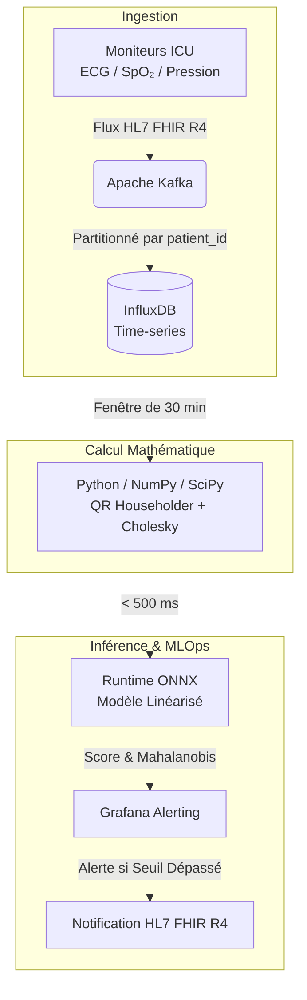

# Prédiction du Sepsis en Réanimation (ICU) : Régression Linéaire, QR Householder, Cholesky et Détection d’Anomalies

> **Santé · Réanimation ICU · Données Cliniques**
> Document structuré pour : Mémoire / Rapport académique, Présentation technique, Dossier portfolio IA/Data, Soutenance, Architecture MLOps Santé.

## Résumé Exécutif
Ce projet vise à détecter la **dégradation silencieuse d'un patient en soins intensifs** (sepsis, arrêt cardiaque, défaillance multi-organes) plusieurs heures avant l'événement critique. 
Le système repose sur la résolution d'un système sur-déterminé ($m \gg n$ : plus de mesures que d'inconnues cliniques) avec des méthodes d'algèbre linéaire avancées garantissant une grande stabilité numérique.

**Sources de Données :**
- [MIMIC-IV](https://mimic.mit.edu/) (~50k patients)
- PhysioNet Challenge
- eICU Collaborative Research Database

---

## 1. Objectif du Projet
Détecter précocement une dégradation clinique en unité de soins intensifs (ICU) :
- Sepsis et choc septique,
- Arrêt cardiaque,
- Défaillance multi-organes.

Le système calcule un **score de risque continu**, mis à jour toutes les 30 minutes à partir des constantes vitales du patient.

---

## 2. Problème Mathématique
Le problème est formulé comme un système sur-déterminé :
$$
A \in \mathbb{R}^{m \times n}, \quad m \gg n
$$
Où :
- $m$ = nombre de mesures temporelles
- $n$ = nombre de variables cliniques

**Vecteur des variables cliniques ($x$) :**
$$
x = \begin{bmatrix} 
\text{SpO}_2 \\ 
\text{FC} \\ 
\text{Température} \\ 
\text{Pression} \\ 
\text{Lactate} 
\end{bmatrix}
$$

**Cible ($b$) :**
$$
b = \text{Score SOFA (Sepsis-related Organ Failure Assessment)}
$$

**Objectif d'optimisation :**
$$
\min \|Ax - b\|_2^2
$$

---

## 3. Pourquoi les Moindres Carrés ?
Les données extraites des moniteurs ICU sont généralement :
- **Bruitées** et **incomplètes**,
- **Corrélées** et **hétérogènes**.

La méthode des moindres carrés permet :
1. D’obtenir le meilleur ajustement global sur une fenêtre temporelle,
2. De réduire significativement l’impact du bruit des capteurs,
3. De produire un score de risque robuste.

Le résidu à minimiser est :
$$
r = Ax - b
$$

---

## 4. Problème des Équations Normales
L'approche classique par les équations normales est :
$$
A^T A x = A^T b
$$
Bien que rapide, elle est **instable numériquement**.

En effet, le conditionnement de la matrice au carré amplifie les erreurs :
$$
\kappa(A^T A) = \kappa(A)^2
$$
Si $\kappa(A) = 1000$, alors $\kappa(A^T A) = 10^6$. Le système devient très mal conditionné, conduisant à des prédictions aberrantes.

---

## 5. Solution : Factorisation QR par Réflexion de Householder
Pour éviter l'instabilité, on factorise $A$ :
$$
A = QR
$$
Avec :
- $Q^T Q = I$ (matrice orthogonale)
- $R$ : matrice triangulaire supérieure

**Réflexion de Householder :**
$$
H = I - 2 v v^T
$$
Où $v$ est le vecteur de Householder unitaire défini par :
$$
u = x \pm \|x\|_2 e_1, \quad v = \frac{u}{\|u\|_2}
$$

Cette méthode :
- Annule de façon itérative les coefficients sous la diagonale,
- Évite l’amplification des erreurs numériques,
- Garantit une stabilité nettement supérieure aux équations normales.

---

## 6. Résolution du Système
Après la factorisation QR, le système devient :
$$
Rx = Q^T b
$$
Comme $R$ est triangulaire supérieure, on utilise la **substitution arrière**. Cette opération présente une complexité algorithmique très faible tout en conservant une excellente stabilité.

---

## 7. Cholesky pour l’Accélération
Pour certaines opérations impliquant des matrices Symétriques Définies Positives (SPD) comme la covariance $\Sigma$ :
$$
\Sigma = L L^T
$$
Où $L$ est une matrice triangulaire inférieure.

Les éléments sur la diagonale de $L$ sont calculés comme suit :
$$
L_{ii} = \sqrt{\Sigma_{ii} - \sum_{k=1}^{i-1} L_{ik}^2}
$$
Et les éléments hors-diagonale ($i > j$) :
$$
L_{ij} = \frac{1}{L_{jj}} \left( \Sigma_{ij} - \sum_{k=1}^{j-1} L_{ik} L_{jk} \right)
$$

**Résolution du système associé :**
Pour résoudre $\Sigma x = b$, on effectue une résolution en deux étapes :
1. **Descente triangulaire (Forward Substitution) :** résoudre $L y = b$
2. **Remontée triangulaire (Backward Substitution) :** résoudre $L^T x = y$

**Avantages :**
- Très rapide,
- Empreinte mémoire réduite,
- Idéal pour le calcul de la covariance et des distances de Mahalanobis.

---

## 8. Détection d’Anomalies : Distance de Mahalanobis
Le patient est comparé en temps réel à une population ICU stable.
Le score d'anomalie est la distance de Mahalanobis au carré :
$$
d^2(x) = (x - \mu)^T \Sigma^{-1} (x - \mu)
$$
Cette distance permet :
- Une détection multivariée,
- La prise en compte des corrélations physiologiques,
- Une alerte bien avant le franchissement des seuils uni-variables classiques.

**Déclenchement de l'alerte :**
On lève une alerte si $d^2(x) > \chi^2(p, 0.99)$ (où $\Sigma^{-1}$ est calculé efficacement via la décomposition de Cholesky $\Sigma = L L^T$).

---

## 9. Linéarisation du Modèle de Risque Exponentiel
Le risque clinique (dégradation) suit souvent une loi exponentielle ou de puissance :
$$
\text{Risque} = a e^{b x}
$$

Par transformation logarithmique, on obtient :
$$
\ln(\text{Risque}) = \ln(a) + b x
$$

Le problème devient strictement linéaire :
$$
Y = A + B x
$$
*(Alternative power law : $\ln(y) = \ln(a) + b \ln(x)$)*

**Bénéfices :**
- Utilisation des moindres carrés classiques,
- Entraînement et mise à jour ultra-rapides,
- Export ONNX simplifié pour l'inférence.

---

## 10. Architecture et Pipeline de Données

---

## 11. Technologies Utilisées

| Domaine | Technologie de Choix |
| :--- | :--- |
| **Streaming / Event Bus** | Apache Kafka |
| **Standard Médical** | HL7 FHIR R4 |
| **Base de Données Temporelle** | InfluxDB |
| **Calcul Scientifique Algébrique** | Python (NumPy, SciPy) |
| **Exportation / Inférence ML** | ONNX Runtime |
| **Monitoring & Observabilité** | Grafana |
| **Données d'Entraînement ICU** | MIMIC-IV / eICU |
| **Déploiement / Orchestration** | Docker + Kubernetes |

---

## 12. Algorithme Global Pas-à-Pas

1. **Construction des Features :** Construire $A \in \mathbb{R}^{m \times n}$ avec $m$ mesures du patient et les $n$ variables cliniques (SpO₂, FC, Température, Pression, Lactate). Définir $b$ comme le score de gravité (SOFA).
2. **Vérification du Conditionnement :** Calculer $\kappa(A)$. Si $\kappa(A) \gg 1000$, les équations normales risquent de faillir. On applique la factorisation QR Householder.
3. **Factorisation QR :**
   - Pour chaque colonne $i$ de la matrice, définir le vecteur de Householder :
     $$ u = x \pm \|x\|_2 e_1, \quad v = \frac{u}{\|u\|_2} $$
   - Appliquer la réflexion $H = I - 2 v v^T$ à la matrice pour annuler les coefficients sous la diagonale.
4. **Résolution :** Résoudre $R x = Q^T b$ par substitution arrière ($x_i$ est calculé en remontant de $x_n$ à $x_1$).
5. **Modèle de Risque :** Résoudre le système linéaire du modèle de risque exponentiel $\ln(\text{Risque}) = \ln(a) + b x$ pour identifier les paramètres $a$ et $b$.
6. **Détection d’Anomalie :** Calculer la matrice de covariance $\Sigma$ sur les patients stables, décomposer $\Sigma = L L^T$ via Cholesky, calculer $\Sigma^{-1} = (L^{-1})^T L^{-1}$ et évaluer la distance de Mahalanobis $d^2(x)$ de chaque nouveau patient.

---

## 13. Validation Mathématique
Le système vérifie rigoureusement les propriétés mathématiques suivantes :
- **Orthogonalité de $Q$ :** $Q^T Q = I$ (conservation des longueurs et des angles)
- **Conservation du produit matriciel (QR) :** $R^T R = A^T A$ (permet de s'assurer de l'équivalence avec les équations normales sans en subir l'instabilité numérique)
- **Stabilité de substitution :** $R x = Q^T b$
- **Conditionnement amélioré :** $\kappa(R) = \kappa(A) < \kappa(A^T A)$
- **Minimisation globale :** $\|A x - b\|_2$ est minimal au sens des moindres carrés.

---

## 14. Résultats Attendus

**Performance Clinique :**
- 🚨 Détection du sepsis **2 à 6 heures avant** l'événement clinique grave.
- 📉 Réduction significative des faux positifs par rapport aux seuils classiques.
- 🕒 Surveillance continue (Score MAJ toutes les 30 min).

**Performance Informatique :**
- ⚡ Inférence ultra-rapide : **< 500 ms**.
- 🚀 Architecture scalable (Multi-patient concurrentiel).
- 🛡️ Calcul parfaitement stable numériquement.

---

## 15. Forces Scientifiques du Projet
1. **Mathématiques Appliquées :** Algèbre linéaire numérique, stabilité algorithmique, optimisation quadratique, statistiques multivariées.
2. **IA Médicale :** Early Warning Systems (EWS), Anomaly Detection, Régression clinique en temps réel.
3. **Architecture Data / MLOps :** Streaming médical temps réel, pipeline MLOps Santé, interopérabilité (FHIR).

---

## 16. Extensions Futures (Roadmap)
- 🧠 Réseaux de neurones séquentiels : **LSTM / Transformer ICU**
- 🎯 Filtrage prédictif : **Kalman Filters** & **Bayesian Updating**
- ⏳ Analyse de survie : **Survival Analysis**
- 🔒 Apprentissage collaboratif : **Federated Learning** inter-hospitalier
- 🖥️ Accélération matérielle : **GPU inference (CUDA)**
- 💡 Explicabilité des modèles : **Explainable AI (SHAP)**

---
*Ce rapport synthétise une architecture robuste combinant l'algèbre linéaire avancée et l'ingénierie de données temps réel pour une application critique en milieu hospitalier.*
